# Ren 連 — Japanese from zero to N3 (Android)

A native Android app built from the *Ren Architecture Spec v1.1* and the *Ren App Design* prototype:
iOS Human Interface styling on Jetpack Compose (no Material components), Clean Architecture + MVI,
an FSRS v5 scheduler, radical-first kanji, and answers that are always drawn or typed, never picked.

| Today | Path | Matrix | Reader |
|---|---|---|---|
| 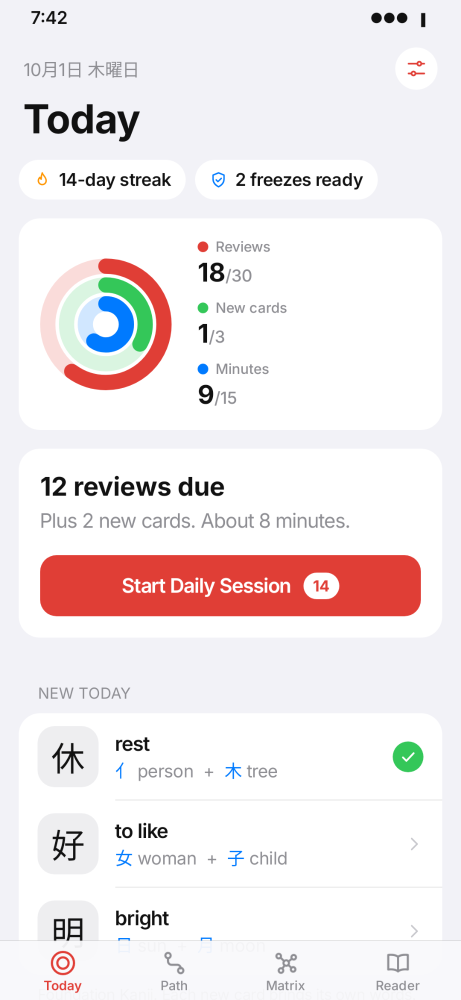 | 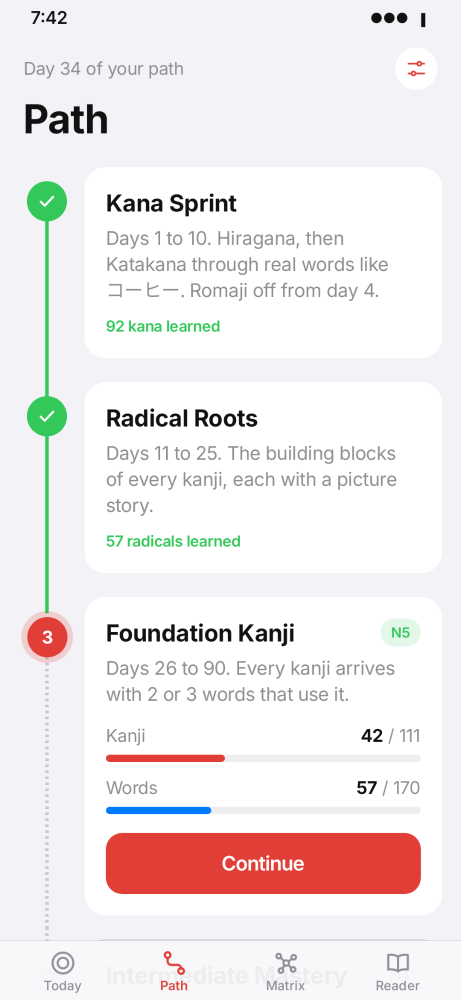 | 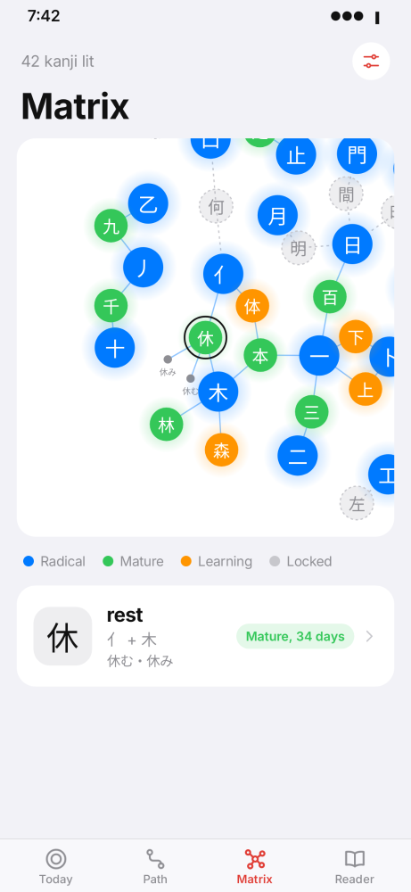 | 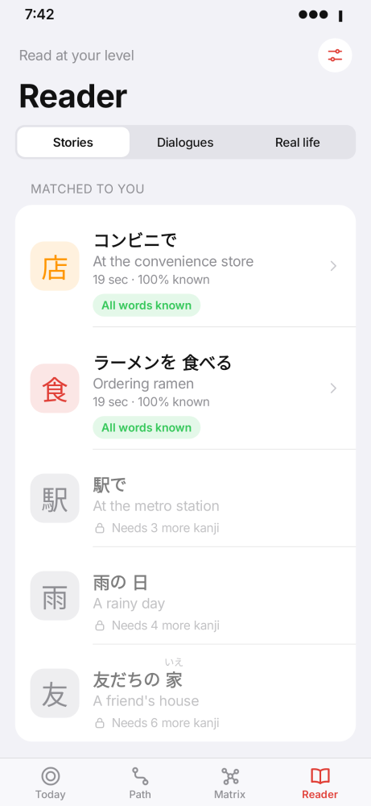 |

The six-step kanji flow (spec §6A):

| 1 Pull it apart | 2 Picture it | 3 Write it | 4 Find it | 5 Recall it | 6 Rate it |
|---|---|---|---|---|---|
| 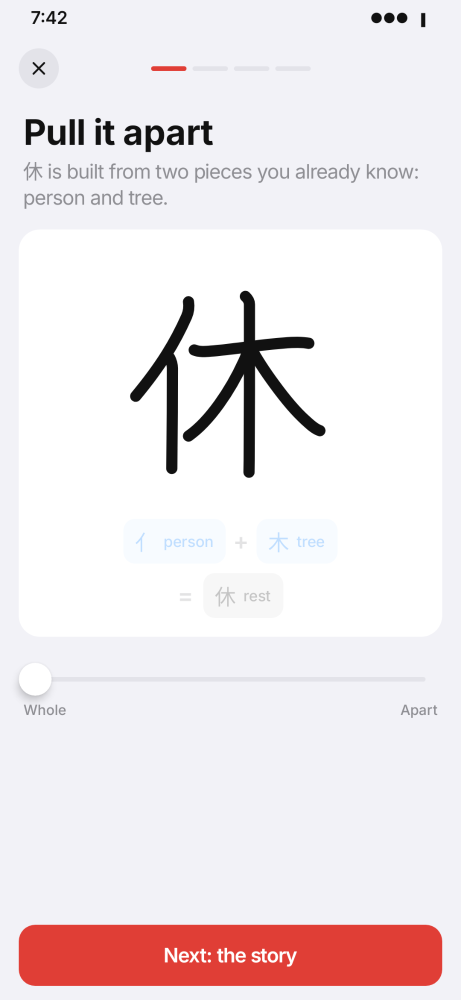 | 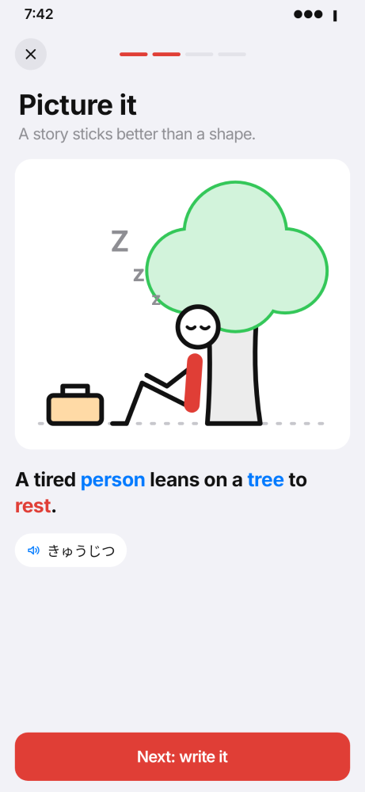 | 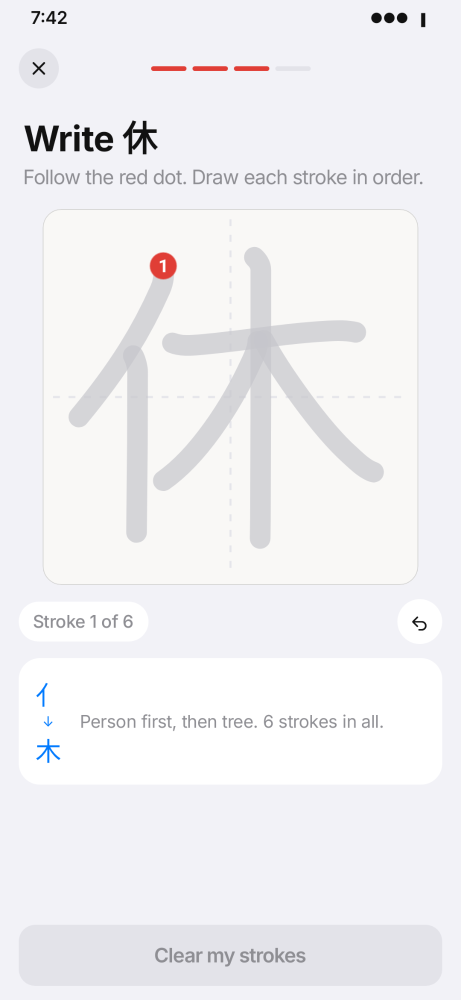 | 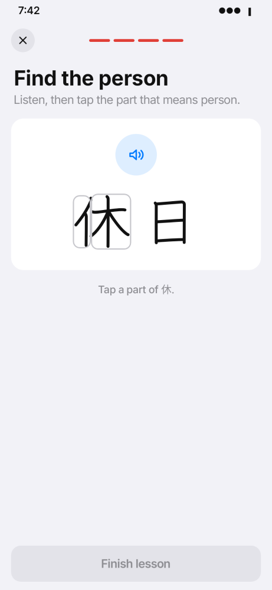 | 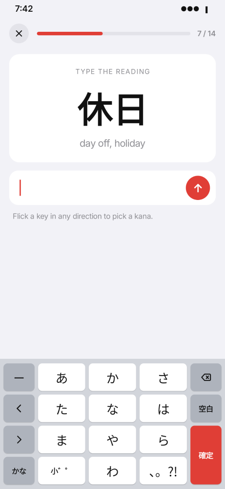 | 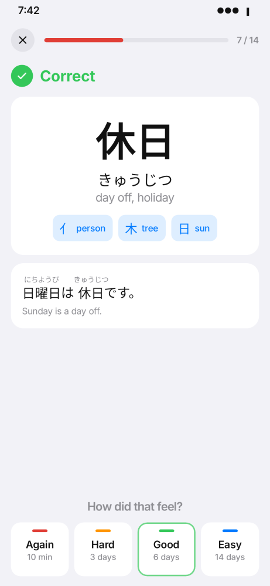 |

Reading, verb pairs and sentence mining (spec §7), dark mode:

| Word sheet | Save a sentence | Learn the pair | Dark |
|---|---|---|---|
| 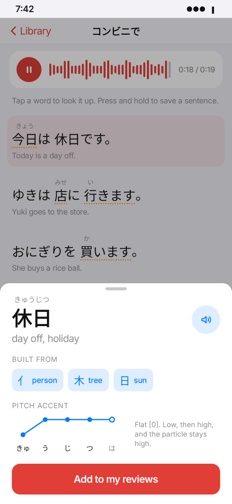 | 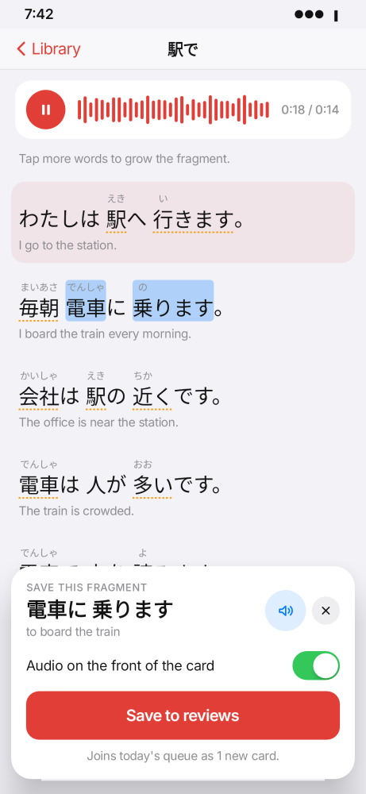 | 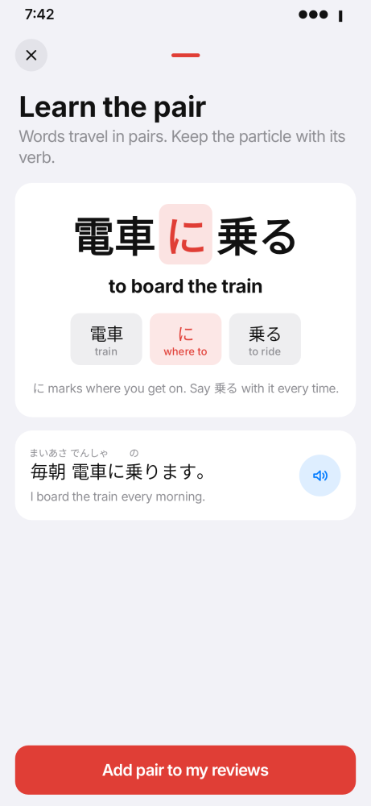 | 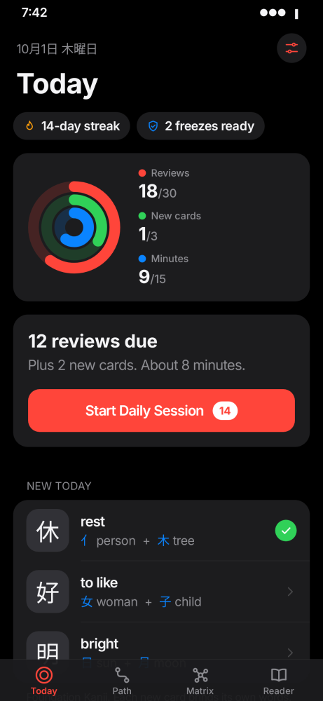 |

All 25 renders live in `app/src/test/snapshots/images`.

## What is in the box

**Curriculum** (bundled as `app/src/main/assets/database/ren_core.db`, 450 KB):
92 kana in 20 groups of five, 57 radicals, 143 kanji (111 Foundation/N5, 32 Intermediate/N4),
228 words with example sentences, 13 verb–particle pairs, and 10 graded stories, dialogues and real-life
texts. That is 233 lesson units and 533 review cards. Every kanji, radical and kana carries real
stroke-order data; every kanji's radicals are mapped to actual stroke groups.

**Screens:** onboarding, the four tabs, stage detail, the study session (lessons, reviews, summary),
the story reader with word sheet and mining tray, item detail with animated stroke order, settings,
a home-screen widget, and the daily reminder notification.

## Spec coverage

| Spec | Where |
|---|---|
| §2 Colour tokens, type scale, springs, press-to-96% | `core/designsystem/theme/Theme.kt`, `components/Components.kt` (`pressable`) |
| §2 Frosted bars: 20 dp backdrop blur on API 31+, translucent fallback | `components/Bars.kt` (`frostedGlass`, via Haze) |
| §2 Haptics: tick per stroke, click on submit, double heavy click on a miss | `core/haptics/Haptics.kt` |
| §2 Velocity-tracked swipe-down sheets | `components/Sheet.kt` |
| §3 Dual coding, radical-first equations, production-only answers, furigana fading, romaji off after day 3 | `feature/session/*`, `domain/usecase/Insights.kt`, `feature/settings` |
| §3 Micro-dosing cap, streak freezes (burnout shield) | `domain/usecase/Planner.kt` (`SessionPlanner`), `Time.kt` (`Streak`) |
| §4 Four stages with stability-gated unlocking | `CurriculumPlanner` (80% graduated; Intermediate needs 7-day stability) |
| §5 Today / Path / Matrix / Reader | `feature/today`, `feature/path`, `feature/matrix`, `feature/reader` |
| §6B Stroke canvas: Bezier smoothing, order, direction, tolerance-band matching | `components/StrokePad.kt`, `domain/ink/StrokeMatcher.kt` |
| §6C 12-key flick keyboard with four-way petals | `components/FlickKeyboard.kt` |
| §6D Radical deconstruction slider | `feature/session/LessonSteps.kt` (`PullApartStep`) |
| §7 Collocations and audio-first sentence mining, `cardType` discriminator | `LessonPlanner.prompt`, `MiningRepository`, `ReaderScreens.kt` |
| §8 FSRS v5 with the spec's weights, learning steps, ordered intervals | `domain/fsrs/FSRSScheduler.kt` |
| §9 Room entities and `StudyDao`, seeded with `createFromAsset` | `data/local`, `tools/seed/build_seed_db.py` |
| §10 Hilt, SoundPool + Media3, `ReviewReminderWorker` at 8 PM with deep link | `di`, `core/audio`, `work/Reminders.kt` |
| §11 MVI: one `StateFlow`, one `onIntent`, effects through a buffered `Channel` | `core/mvi/Mvi.kt` and every `*ViewModel` |
| §13 iOS push/pop and modal transitions | `navigation/RenApp.kt` |

## Decisions worth knowing

- **Audio.** The spec's `AudioEngineManager` is implemented as written (SoundPool for short clips,
  ExoPlayer for long stories), but no recorded native audio ships with the content. Every item with
  an empty `audioAssetPath` is voiced by the device's Japanese text-to-speech. Drop real recordings
  into `assets/` and set the path to switch an item over. SoundPool plays three synthesised UI sounds.
- **Illustrations.** 休 has the prototype's line drawing. Other characters get a generated picture:
  the character draws itself in stroke order with each radical tinted, so step 2 stays visual.
- **Preferences** use a typed DataStore stored in protobuf wire format via
  `kotlinx-serialization-protobuf`. Same API as Proto DataStore, no `protoc` build step.
- **Schema upgrades** use `fallbackToDestructiveMigration()` as the spec does. That also resets
  progress, which lives in the same database; add real migrations before the first schema change.
- **Content size.** The spec targets 120 N5 kanji and 600 words; the seed has 143 kanji and 228 words.
  The pipeline below scales to more without code changes.
- **Flick keyboard.** The prototype's `☆123` and `あいう` keys were decorative, so those slots are a
  working `ー` key and a かな/カナ toggle instead.
- **New-word marks in stories** count kanji words and curriculum words. Everyday kana phrases
  (ありがとう, コーヒー) are tappable and addable but do not count against i+1.

## Build and run

Requirements: JDK 17+ and the Android SDK with platform 35 (`local.properties` → `sdk.dir=…`).

```bash
./gradlew :app:assembleDebug          # app/build/outputs/apk/debug/app-debug.apk
./gradlew :app:testDebugUnitTest      # domain, Room-on-Robolectric and screenshot tests (55)
./gradlew :app:recordPaparazziDebug   # re-render the screenshots
./gradlew :app:assembleRelease        # R8-minified, 3.9 MB (sign it with your own key)
```

Min SDK 26, target SDK 35. Kotlin 2.0, Compose BOM 2024.12, Hilt 2.52, Room 2.6, Media3 1.5,
WorkManager 2.10, Glance 1.1, Navigation 2.8 type-safe routes.

## Changing the content

Curriculum lives in `tools/seed/content/` as plain text:
`kana.tsv`, `radicals.tsv`, `kanji.tsv` (parts may be radicals or earlier kanji), `vocab.tsv`,
`collocations.tsv` and `stories.txt`. Japanese uses inline ruby markup:
`{日曜日|にちようび}は{休日|きゅうじつ}です。`, with an optional dictionary form: `{食べます|たべます|食べる}`.

```bash
./gradlew :app:kspDebugKotlin           # only after changing Room entities: refreshes app/schemas
python3 tools/seed/build_seed_db.py     # rebuilds the bundled database
python3 tools/sfx/make_sfx.py           # rebuilds the three UI sounds
```

The builder fetches KanjiVG, KANJIDIC2 and Kanjium on first run (cached in `tools/seed/.cache`),
matches each kanji's authored parts to real stroke groups, fills readings, stroke counts and pitch
accents, checks that every story word resolves, and writes the database using the `createSql`
from Room's exported schema, so Room always accepts it. `SeedDatabaseTest` opens the result through
Room in CI to prove it.

## Architecture

```
app.ren
├── core/designsystem   Cupertino primitives: theme, bars, sheets, pad, flick keyboard, ruby text
├── core/{audio,haptics,mvi}
├── domain              Pure Kotlin: models, FSRS, stroke matcher, planners, repository interfaces
├── data                Room entities and DAOs, DataStore, repository implementations
├── feature/*           One MVI ViewModel + stateless screen per feature
├── navigation          Type-safe routes, tab shell, transitions
├── work, widget        Reminder worker and notification, Glance widget
└── di                  Hilt modules
```

## Verification status

Built and tested in a cloud container without an emulator: unit tests (FSRS maths, furigana
alignment, pitch contours, stroke matching, curriculum gating, streaks), Robolectric tests that open
the real seed database through Room and run a lesson-to-graduation pass, and Paparazzi renders of
every screen in light and dark. It has **not** yet been run on a physical device or emulator, so
touch feel, TTS voice availability, haptics and the notification/widget round trip still need a
hands-on pass.

See [NOTICE.md](NOTICE.md) for data and font licences.
